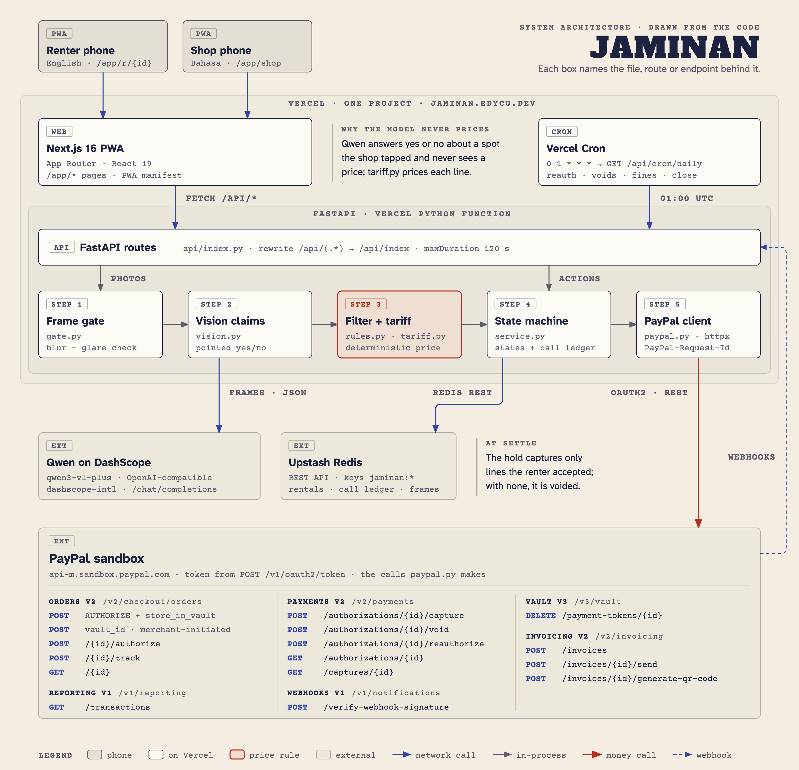
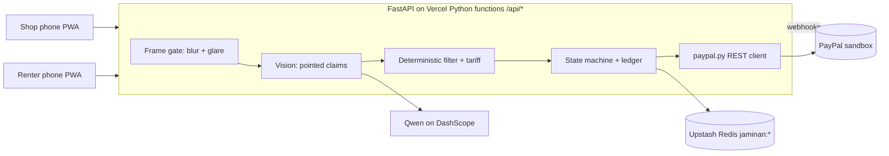

<div align="center">
  
  <h1>Jaminan 🛵</h1>
  <p><em>A PayPal hold that replaces the passport at the scooter-rental counter. The shop points, the shared baseline answers, and PayPal moves only the money the renter accepted.</em></p>
  

  <br/>

  [](https://jaminan.edycu.dev/app)
  [](https://jaminan.edycu.dev/app/judge)
  [](https://jaminan.edycu.dev)
  [](https://jaminan.edycu.dev/pitch/)
  [](https://paypalaihackathon.devpost.com/)

  <br/>

  
  
  
  
  
  [](LICENSE)

</div>

---

## 💡 The Problem & Solution

### The Problem

In Bali and Jakarta the deposit on a rented scooter is often your passport (or a local's KTP). At return the shop points at a dent, the renter says it was already there, and whoever holds the document wins the argument. Neither side has evidence they both saw, and the "deposit" is a document, not money either side can trust.

### The Solution

Jaminan replaces the passport with a PayPal authorization and replaces the argument with a shared walkaround.

**What runs today, on the PayPal sandbox:** at [`/app/judge`](https://jaminan.edycu.dev/app/judge) one tap authorizes $115.00 on a saved sandbox wallet, captures the $15.00 fee, writes the handover tracking, and releases the hold on a second tap, each stamp waiting for PayPal's read-back. No vision model is pinned as benchmarked yet, so a live rental cannot price a damage line. The priced path is a recorded sandbox run with scripted claim answers ([`evidence/paypal-sandbox-run.json`](evidence/paypal-sandbox-run.json): one $18.00 capture with `final_capture=true`, the other $82.00 released, a second capture refused with 422) and is exercised in the unit and sandbox tests.

1. The renter scans the shop QR and gives **one PayPal approval** that authorizes the fee plus the deposit and saves the wallet for later fines. The fee is captured when both sides confirm the baseline at pickup; the deposit stays held.
2. A guided 8-angle walkaround records the scooter at pickup. Renter and shop confirm the baseline together.
3. At return **the owner points, the shared baseline answers.** The shop taps a mark and picks its `(part, damage_class)` from the published tariff. The model only answers what the pickup photos show; it never sets a price.
4. Code decides: no mark at return, visible at pickup, or not comparable at pickup all mean **cannot be charged**, and a mark that doesn't look like the kind the shop named can't be paid from the hold. Only clearly new damage becomes a priced line.
5. **The hold only pays lines the renter accepted.** Accepted lines become one capture with `final_capture=true`. A clean return voids the hold. A contested line goes out as an itemized PayPal invoice at its tariff price.

> **What the shared baseline can't show, nobody can charge.**

## 🏗️ Architecture & Tech Stack



*Every box names the file, route or endpoint behind it. Source: [`docs/architecture.html`](docs/architecture.html) ([live](https://jaminan.edycu.dev/architecture.html)).*

<details><summary>Mermaid source</summary>



</details>

| Layer | Technology |
|---|---|
| UI | Next.js 16 PWA (App Router), React 19, TypeScript. Bahasa on shop screens, English on renter screens |
| API | Python 3, FastAPI, httpx, Pydantic, deployed as Vercel Python functions |
| Frame gate | numpy + Pillow: Laplacian-variance blur and clipped-highlight glare checks, no model call to reject a bad frame |
| Vision | Qwen via DashScope (OpenAI-compatible, image input, JSON-schema answer) |
| Storage | Upstash Redis, one JSON document per rental, keys prefixed `jaminan:` |
| Jobs | One Vercel Cron entry `/api/cron/daily` (reauth sweep, expiry guard, daily close) |

## 🏆 PayPal Integration

PayPal is the engine, not a decoration: the deposit **is** an authorization, and its whole lifecycle is the product. The REST client is hand-written in [`jaminan/paypal.py`](jaminan/paypal.py).

```
approve (Orders v2 AUTHORIZE + vault consent)
   → capture fee (final_capture=false)  → tracking on the fee capture
   → claims → renter accepts lines
   → { capture accepted lines (final_capture=true) | void }
   → [reauthorize on day 4 for rentals over 3 days]
   → [invoice: contested lines / damage above the hold]
   → [later fine: merchant-initiated capture on the vaulted wallet]
```

| PayPal surface | Used for |
|---|---|
| Orders v2 `AUTHORIZE` with `store_in_vault` | one approval: fee + deposit hold + saved wallet |
| Payments v2 capture (`final_capture` false/true) | fee now, accepted damage lines at settle |
| Payments v2 void | clean return releases the hold |
| Payments v2 reauthorize | re-secures long rentals (Day 4 to Day 29 window) |
| Vault v3 + merchant-initiated charges | later fines on the saved wallet |
| Shipment tracking | handover record on the fee capture; the tracking number carries the first 8 hex characters of the baseline SHA-256 |
| Invoicing v2 | contested lines and damage above the hold, with an evidence-pack link |
| Webhooks v1 and `GET /api/integrations/verify` | events checked with PayPal's verify-webhook-signature call when a webhook id is configured and stored with their verified/failed flag; live read-back of PayPal state |

The APIMatic Context Plugin was used once, to write a Transaction Search call through PayPal's generated SDK ([`docs/APIMATIC.md`](docs/APIMATIC.md)): the request authenticated and PayPal answered 403 `NOT_AUTHORIZED`, because the sandbox app lacks permission for Transaction Search (we believe the feature is not enabled). The client itself is hand-written. The settle screen shows the status read back from PayPal after the call. Real-sandbox tests in [`tests/`](tests) cover authorize, vault, capture, void and invoice; tracking, webhooks and fine capture are covered by offline tests. Outside the tests, tracking runs in the recorded sandbox runs and on every `/app/judge` rental, and incoming webhooks are checked with PayPal's signature call and listed with the result on [`/app/integrations/verify`](https://jaminan.edycu.dev/app/integrations/verify); the fine capture has no sandbox run.

### How this differs

| Existing approach | What it does | What it does not do |
|---|---|---|
| AI fleet-inspection products (e.g. [Monk](https://monk.ai), [Ravin](https://ravin.ai), [ProovStation](https://www.proovstation.com)) | Detect damage on vehicle photos | Their sites do not describe a payment hold, capture or release, as far as we found |
| Turo-style photo check-in | Both sides photograph the car on a marketplace | Tie the photos to an authorization that only accepted lines can capture, as far as we found |
| A phone video before you ride | The renter's own record | Carry a co-signature, or get the passport back |

## 📊 Engineering Rigor

| Metric | Value |
|---|---|
| Tests collected | 140 (`pytest`): 131 offline unit, contract and invariant tests, 8 against the real PayPal sandbox (including `CAPTURED` and second-capture `422` read-backs), 1 live Qwen schema check |
| Claim-decision sweep | `decide_claim` run over 23,040 combinations of the five yes/no answers, serving model (pinned, other, none), confidence, a confirmed baseline mark, a low-comparability tile, three parts and five damage classes: every chargeable result satisfies every "new since pickup" condition and carries a tariff price ([`tests/test_invariants.py`](tests/test_invariants.py)) |
| Settle property test | up to 3,000 generated settlements (Hypothesis): the hold pays exactly the accepted chargeable lines at their tariff price, blocks exactly when a line is mispriced, or unanswered and the settle is not forced; invoices only contested lines plus any accepted amount above the deposit; and never captures more than the authorization |
| Offline coverage | 90% of `jaminan/` (`pytest --cov`, 1,581 statements) |
| CI | GitHub Actions: ruff, mypy, offline tests with coverage, pip-audit and an API boot smoke; eslint, `tsc`, production build and `npm audit`; gitleaks over full history; CodeQL (Python and TypeScript) once the repo is public; Dependabot monthly, grouped, no major bumps |
| Live acceptance script | `scripts/e2e_live.py` (375 px viewport) |
| Evidence pack | [`evidence/`](evidence): three recorded PayPal sandbox settlements call by call (`scripts/record_paypal_evidence.py`), the full test run, offline coverage and the live e2e log |
| Vision accuracy | **Not yet measured.** Benchmark on the staged scooter set is pending |

### Honest limits (6)

1. **Sandbox only.** Nothing here has moved live money; live vault and merchant-initiated eligibility are unverified.
2. **One merchant.** The demo uses a single sandbox merchant; a production path needs one onboarded merchant per shop.
3. **Wallet path only.** The card-path authorize answered 422 on 2026-10-14 without a stated reason (PayPal's response gave none; we believe advanced card processing is not enabled for this Indonesia-region sandbox merchant), so cards are out of scope.
4. **Non-return is out of scope.** Jaminan covers damage and fines, not a scooter that never comes back.
5. **No vision accuracy claim yet.** Until the benchmark runs, no finding from a non-benchmarked model is chargeable.
6. **Reauthorize is proven on the sandbox, not yet through the rental flow.** On 2026-10-23 (day 9) PayPal accepted `reauthorize` on a plain hold and on a hold that already had its fee captured (201 both), and refused a second one on the same hold (422 `REAUTHORIZATION_TOO_SOON`, "only allowed once"): [`evidence/paypal-reauthorize.jsonl`](evidence/paypal-reauthorize.jsonl). The sweep's day-4 trigger rule and its refusal fallback (re-authorize on the vaulted wallet, then void the old hold) are unit-tested, including through `cron_daily()`; the `/api/cron/daily` route and Vercel's schedule have not run on a rental, and no rental has yet reached day 4 through the app.

## 🚀 Getting Started

### Prerequisites

Node 22 (the version CI uses), Python 3.12, a PayPal sandbox app, an Upstash Redis REST database and a Qwen (DashScope) key. Copy the variable names from [`jaminan/config.py`](jaminan/config.py) into `.env.local`.

### Installation

```bash
git clone https://github.com/edycutjong/jaminan && cd jaminan
npm install && python3 -m venv .venv && .venv/bin/pip install -r requirements-dev.txt
npm run dev:api & npm run dev
```

Or skip setup: open the live [`/judge`](https://jaminan.edycu.dev/app/judge) route, which mints a fresh sandbox rental on one tap and lets you release the hold. Priced lines are in the recorded settlements in [`DEMO.md`](DEMO.md).

## 🧪 Testing & CI

```bash
make ci                                                                       # ruff, mypy, offline tests + coverage, pip-audit, eslint, tsc, build, npm audit
.venv/bin/python -m pytest -m "not sandbox and not live_model and not slow"   # offline suite only
.venv/bin/python -m pytest                                                    # + real sandbox, live Qwen, headless browser (needs credentials)
python scripts/e2e_live.py https://jaminan.edycu.dev/app --shots /tmp/jaminan-e2e   # live acceptance as two phones at 375 px
```

The sandbox, live-model and browser tests need credentials, so CI runs the offline suite only; run them yourself with the third command. Tests that pin a fixed defect are named for it. [`.env.example`](.env.example) lists every variable.

## 📁 Project Structure

```
app/        Next.js screens: renter (r/), shop (shop/), judge, integrations/verify
api/        FastAPI entry (Vercel Python function)
jaminan/    paypal.py · rules.py · gate.py · vision.py · service.py · tariff.py · store.py
fixtures/   published tariff, fine ceilings, shop and vehicle seed
tools/label labelling tool for the staged photo set
tests/      unit, contract, invariant and real-sandbox tests
.github/    CI, CodeQL, gitleaks, Dependabot, community files
```

## 🗺️ Roadmap

- [x] PayPal lifecycle: authorize, capture, void, vault, invoice, tracking
- [x] Pointed-claim rules in code, tariff-priced
- [x] Judge route with a fresh sandbox rental
- [ ] Vision benchmark on a staged scooter set
- [x] Reauthorize sandbox run (2026-10-23: 201 on two holds, second attempt 422)
- [ ] MCP rental tool for booking agents

## 📽️ Demo Materials

- Walkthrough, recorded PayPal settlements with ids, reproduce commands: [DEMO.md](DEMO.md)
- Live app: https://jaminan.edycu.dev/app
- Judge path: https://jaminan.edycu.dev/app/judge
- PayPal call log: https://jaminan.edycu.dev/app/integrations/verify (add `?rental=<id>` for one rental's calls and a live read-back)
- Landing page: https://jaminan.edycu.dev
- Pitch deck: https://jaminan.edycu.dev/pitch/ ([PDF](docs/pitch/jaminan-pitch-deck.pdf))

## 📄 License

[MIT](LICENSE)
